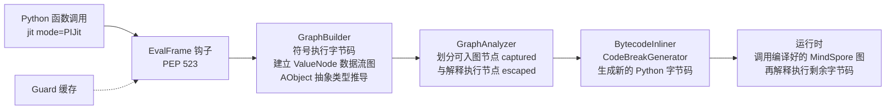
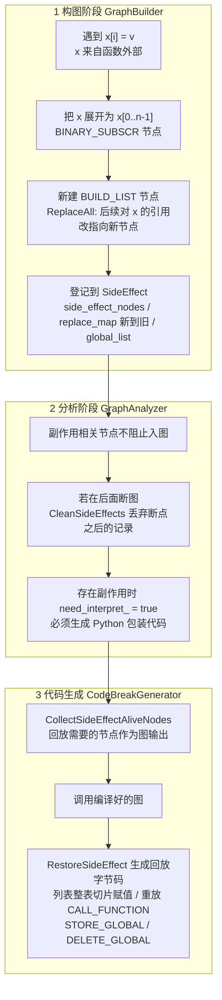

# MindSpore PIJit 贡献合集：字节码级 JIT 的副作用处理与类型推导

[English version](README_EN.md)

这个仓库收录了我（GitHub [@YUNPUWU](https://github.com/YUNPUWU)，Gitee `wu-yunpu`，提交署名 `wu-yunpu` / `吴蕴溥` / `w30010434`）在 2023 年 11 月到 2024 年 3 月之间提交给华为开源 AI 框架 [MindSpore](https://github.com/mindspore-ai/mindspore) 的全部代码，并逐项说明每个改动要解决什么问题、怎么设计、为什么这样做。

所有改动都已合入上游主线，GitHub 镜像上的 `v2.3.0` 标签包含这些提交。

## 一句话概括

我的工作集中在 MindSpore 的 **PIJit**（Python 字节码级 JIT 编译器，思路和 PyTorch 的 TorchDynamo 类似）。核心是新建了 **副作用（side effect）处理模块** `graph_capture/side_effect.{h,cc}`：修改调用方传入的 list 元素的 Python 函数，原来会在这条赋值处断图（graph break），现在可以整段编译成静态图，副作用在图执行完后按原语义回放。之后我又把这个模块重构成统一的“记录 → 回放”框架，同事加入的全局变量写入、`dict.pop` 处理也一起收了进来。另外我还补全了元组/列表切片和乘法的抽象类型推导，修复了几个字节码兼容性问题（Python 3.9 的 `LIST_EXTEND`、keyword-only 参数、`FOR_ITER` 断点），并完成了一轮静态检查清理。

## 数据一览

| 项目 | 数值 |
| --- | --- |
| 上游仓库 | `mindspore/mindspore`（Gitee 主仓）/ `mindspore-ai/mindspore`（GitHub 镜像） |
| 时间跨度 | 2023-11-25 ～ 2024-03-25 |
| 我发起并合入的 PR | 13 个（另有 3 个由同事发起的分支同步 PR 带入了我的提交） |
| 提交 | 23 个 commit，去重后为 12 个主线补丁 + 3 个内容不同的分支版本 |
| 主线代码量 | +866 / −560 行，涉及 19 个文件（其中 −243 行是删除过时测试） |
| 新建文件 | `side_effect.h`、`side_effect.cc`、`tests/st/pi_jit/control_flow/test_side_effect.py` |
| 主要目录 | `mindspore/ccsrc/pipeline/jit/pi/graph_capture/` |

## 背景：PIJit 是怎么工作的

PIJit 通过 PEP 523 的帧求值钩子（`_PyInterpreterState_SetEvalFrameFunc`）接管被 `@jit(mode="PIJit")` 修饰的函数。它不解析源码，而是直接读 Python 字节码：



遇到无法入图的字节码时，PIJit 会在这里**断图**：前半段编译成图，后半段交回 Python 解释器执行。断图次数（`break_count_`）越少，能编译进图的代码越多，性能越好。我的大部分工作都是在减少断图，同时保证语义不变。更详细的原理介绍见 [docs/00-pijit-primer.md](docs/00-pijit-primer.md)。

## 贡献总览

| # | 主题 | 解决的问题 | PR（Gitee） | 文档 |
| --- | --- | --- | --- | --- |
| 1 | 元组切片类型推导 | `t[a:b:c]` 的结果原来只能推成“未知类型”，下游无法继续推导 | !62405、!63085 | [01](docs/01-type-inference.md) |
| 2 | 列表乘法类型推导 | `[a, b] * n` 的元素类型丢失 | !63085 | [01](docs/01-type-inference.md) |
| 3 | 循环头断图开关 | 追踪到循环头时直接停止并记录 `kStopTraceLoop_Unsupported`，让断图落在循环边界上 | !63765 | [02](docs/02-graph-build-fixes.md) |
| 4 | `FOR_ITER` 断点修复 | 在非循环的 `FOR_ITER` 处断图时，用错了指令来计算代码块结束位置 | !63765 | [02](docs/02-graph-build-fixes.md) |
| 5 | store_attr / store_subscr 保守处理 | 写操作直接改动共享的抽象对象，可能污染其他节点的类型信息 | !63765 | [02](docs/02-graph-build-fixes.md) |
| 6 | Python 3.9 `LIST_EXTEND` 兼容 | 常量列表 `[1, 2, 3]` 在 3.9 中编译为 `LIST_EXTEND <常量元组>`，原实现无法把它合并成 `BUILD_LIST`，之后对这个列表的下标写入会断图 | !63896、!63919 | [02](docs/02-graph-build-fixes.md) |
| 7 | keyword-only 参数 | 生成的新代码对象保留了 `co_kwonlyargcount`，与 PIJit 的扁平传参约定冲突 | !63896 | [02](docs/02-graph-build-fixes.md) |
| 8 | 冗余 `STORE_DEREF` 消除 | 内联后出现“把闭包变量原样写回自己”的无效写，被误判为闭包副作用 | !65004 | [03](docs/03-closure-store-deref.md) |
| 9 | **副作用处理模块（核心）** | 修改调用方传入的 list 会断图；需要统一的副作用记录与回放机制 | !65841、!66290、!66488、!66980、!66983 | [04](docs/04-side-effect.md) |
| 10 | 代码质量 | 公司静态检查（codecheck）告警：有符号位运算、隐式窄化、保留标识符、switch 缺少 return 等 | !67140、!67269 | [05](docs/05-code-quality.md) |

完整的 commit / PR / 分支对照表见 [docs/contribution-log.md](docs/contribution-log.md)。

## 核心工作：副作用处理

### 问题

MindSpore 编译出的静态图是**纯函数**：输入 Tensor，输出 Tensor，不会修改任何 Python 对象。用户代码里却常常有副作用：

```python
@jit(mode="PIJit")
def func(x):                 # x 是调用方传进来的 list
    x[0] = Tensor([1, 2])    # 修改调用方能看到的对象
    x[1] = Tensor([1, 2])
    return x
```

原来的 `GraphBuilder` 只能处理“函数内部 `BUILD_LIST` 新建出来的列表”上的 `STORE_SUBSCR`。像上面这样的外部 list，`DoSetItem` 返回失败，追踪就停在这条字节码上，函数在这里断图。

### 设计思路：记录 → 替换 → 回放



几个关键的设计决定：

1. **图内用函数式表达，图外回放真实修改。** 在图里，“修改后的列表”是一个新的 `BUILD_LIST` 节点，数据流保持纯函数，可以正常做类型推导和编译。对调用方可见的修改不在图里做，而是在图执行结束后，由生成的 Python 字节码在原对象上回放。
2. **新节点到原节点的替换表（`replace_map`）。** `ReplaceAll(old, new)` 把当前帧（以及内联时的父帧）里的局部变量、栈和闭包对旧列表的引用全部换成新节点，后续字节码改为引用这个新节点。同时记下“新到旧”的映射，回放时才能找回调用方持有的原始对象。为了让替换能成功，我放宽了 `ReplaceAll` 的引用检查：纯读操作（`IsGeneralNoSideEffectOp`，比如 `BINARY_SUBSCR`）引用旧节点时不阻止替换。
3. **副作用必须和断图位置一致。** 如果函数后半段因为其他原因断图，断点之后的副作用会由解释器原样执行，不能再回放一次。`CleanSideEffects(stop_bci)` 会删掉 bci 不早于断点的记录，避免重复执行。
4. **支持跨函数内联。** 被内联的子函数（例如 `Cell.construct` 里的 `x[1] = y`）也有自己的 `SideEffect`。`BytecodeInliner::CollectTracedNodes` 在收集节点时调用 `SideEffect::Merge`，把子图的副作用合并到顶层图，统一回放。

### 两个版本的演进

| 版本 | 提交 | 结构 |
| --- | --- | --- |
| v1 | `support side effect`（2024-02-02） | 新建 `SideEffect` 类，但副作用节点、替换表、断点 bci 还分散在 `Graph` 的多个成员里，需要从 `SideEffect` 手动拷贝过去；回放逻辑写在 `CodeBreakGenerator::CallSideEffectCode` 中；`BytecodeInliner::Rebuild` 和 `CodeBreakGenerator::Init` 各写了一份存活节点收集 |
| v2 | `fix side effect bug`（2024-03-12，PR !66488） | 按单一职责重构：`Graph` 只持有一个 `unique_ptr<SideEffect>`；登记、存活节点收集（`CollectSideEffectAliveNodes`）、断点清理（`CleanSideEffects`）、子图合并（`Merge`）、回放（`RestoreSideEffect`）全部收进 `SideEffect`；原始 `STORE_SUBSCR` 也作为节点记录下来，用于在原对象上执行写入；`dict.pop` 的调用节点直接登记为待回放的副作用 |

两个版本之间，同事的 `support dict` 提交加入了 `GlobalSideEffectNode`（记录 `STORE_GLOBAL` / `DELETE_GLOBAL`）和最初的 `dict.pop` 处理，v2 把它们一并收进了 `SideEffect`。

配合这项工作，我新建了系统测试 `test_side_effect.py`（先提交 7 个用例，v2 中调整为 8 个），覆盖 list 元素赋值、`del x[i]`、`dict.pop`（局部字典和参数字典）、`global` 赋值与删除，以及在 `Cell` 内部修改传入列表的场景。断言方式是检查 `get_code_extra(func)["break_count_"] == 0`，以及生成的字节码里确实包含回放用的 `STORE_SUBSCR` / `DELETE_SUBSCR`。

截至 GitHub 镜像最新的 master（2024-07），这个模块已经被社区同事重构成 `SideEffectData` + `SideEffect::Type` 的形式，但“新值到旧值的替换表 + 图执行后回放副作用”这个思路保留了下来（见 `modified_and_replaced_map_`）。

详细的数据结构、字节码层面的回放序列和每个版本的改动见 [docs/04-side-effect.md](docs/04-side-effect.md)。

## 仓库结构

```
.
├── README.md / README_EN.md      项目总览（中文 / 英文）
├── docs/
│   ├── 00-pijit-primer.md        PIJit 原理入门
│   ├── 01-type-inference.md      元组切片、列表乘法的类型推导
│   ├── 02-graph-build-fixes.md   循环头断图、FOR_ITER、LIST_EXTEND、kw-only 参数
│   ├── 03-closure-store-deref.md 冗余 STORE_DEREF 消除
│   ├── 04-side-effect.md         副作用处理模块（核心，最详细）
│   ├── 05-code-quality.md        codecheck 清理
│   └── contribution-log.md       全部 commit / PR / 分支对照表
├── patches/                      git format-patch 导出的原始补丁，保留原作者与时间
│   ├── 01-type-inference/ … 05-code-quality/   主线版本，按主题分组、按时间编号
│   └── variants/                 内容与主线不同的分支版本（mstorch-infer、r2.3）
├── src/                          我新建的文件在全部 PR 合入后的完整版本
│   ├── graph_capture/side_effect.h, side_effect.cc
│   └── tests/test_side_effect.py
├── excerpts/                     包含我改动的上游函数的完整函数体，方便对照阅读
├── scripts/collect_contributions.sh   从上游镜像重新提取全部提交的脚本
└── LICENSE / NOTICE              Apache-2.0，原始版权归华为技术有限公司
```

## 如何核对和复现

检索范围是 GitHub 镜像上的 mindspore、docs、models、mindformers、mindscience、akg、mindspore-lite 等仓库，只有 mindspore 主仓有我的提交。Gitee 上的 PR 描述和评审意见没有收录。

所有提交都可以在 GitHub 镜像上直接查看，例如核心重构 [a080689](https://github.com/mindspore-ai/mindspore/commit/a08068927d5e939aa49fa0b24b2a0c50ba18a235)。在本地重新提取：

```bash
bash scripts/collect_contributions.sh            # 无树克隆（约 50 MB），列出全部提交并导出补丁
```

把任意补丁应用到上游对应的父提交上：

```bash
git clone https://github.com/mindspore-ai/mindspore && cd mindspore
git checkout a08068927^ && git am /path/to/patches/04-side-effect/0009-refactor-side-effect-and-fix-bugs.patch
```

## 回顾：现在会怎么改进

这些是我回看代码时发现的不足：

- **忽略了 `DoSideEffect` 的返回值。** 下标越界或 `ReplaceAll` 失败时，这条写入既不会被记录，也不会触发断图，会被悄悄丢掉。应该在失败时走原来的断图路径。
- **遍历中删除元素。** `SideEffect::CleanSideEffects` 在范围 for 循环里对同一个 vector 调用 `erase`，迭代器会失效。应改为 `erase(remove_if(...))` 一次完成。v1 的 `ReprocessVariableMutationMaps` 对 `std::map` 也有同样的问题。
- **写后读（待验证）。** py3.7 修复后，图里的新列表节点由写入前的元素构建。同一函数里先写后读（`x[0] = t; y = x[0] + 1`）时，图里可能读到旧值，需要补用例确认。
- **切片步长 > 1 时忽略了 start。** `AbstractTuple::GetItem` 在 `step > 1` 的分支里，游标从 0 开始而不是从 `start` 开始，`t[1::2]` 会推导出错误的元素；负步长也直接退化为未知类型。
- **测试只检查断图次数。** 副作用测试断言的是 `break_count_ == 0` 和字节码中有回放指令，没有断言调用方对象回放后的值。应补充“和不加 `jit` 的执行结果逐元素比较”的测试。
- **只支持 list 的 `STORE_SUBSCR`。** `dict` 的下标写入、`list.append` 等仍然走原来的路径，后来社区重构时通过 `SideEffect::Type` 把这些类型统一了起来。

## License

本仓库中的补丁、源码快照和代码摘录均来自 MindSpore 项目，遵循 [Apache License 2.0](LICENSE)，原始版权归华为技术有限公司（Huawei Technologies Co., Ltd.）所有。本仓库只用于展示个人贡献，与华为或 MindSpore 社区没有官方关联。文档部分由本人编写。
