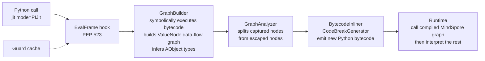
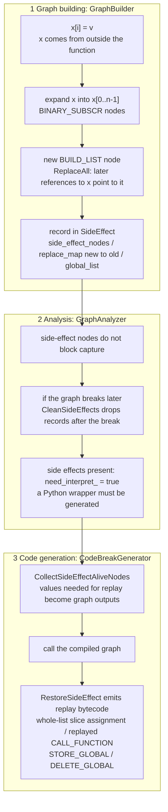

# MindSpore PIJit Contributions: Side-Effect Handling and Type Inference in a Bytecode JIT

This repository collects every change I ([@YUNPUWU](https://github.com/YUNPUWU); Gitee `wu-yunpu`; upstream author names `wu-yunpu` / `吴蕴溥` / `w30010434`) contributed to Huawei's open-source AI framework [MindSpore](https://github.com/mindspore-ai/mindspore) between November 2023 and March 2024. For each change, it explains what problem it solves, how it was designed, and why I made the choices I did.

All changes were merged into upstream mainline, and the `v2.3.0` tag on the GitHub mirror contains them. Each change has a detailed design document in [`docs/`](docs/).

## Summary

My work focused on MindSpore's **PIJit**, a Python-bytecode-level JIT compiler that takes the same approach as PyTorch's TorchDynamo. The main contribution is a new **side-effect handling module**, `graph_capture/side_effect.{h,cc}`. Before it, a function that assigned to an element of a list passed in by the caller broke the graph at that assignment. With it, the whole function compiles into a static graph, and the mutation is replayed with its original semantics after the graph runs. I later refactored the module into a single record-and-replay framework, which also absorbed teammates' handling of global-variable writes and `dict.pop`.

I also added abstract type inference for tuple/list slicing and list repetition, fixed several bytecode compatibility issues (Python 3.9 `LIST_EXTEND`, keyword-only arguments, `FOR_ITER` break points), and cleaned up static-analysis warnings across the module.

## At a glance

| Item | Value |
| --- | --- |
| Upstream | `mindspore/mindspore` on Gitee (primary) / `mindspore-ai/mindspore` on GitHub (mirror) |
| Period | 2023-11-25 to 2024-03-25 |
| PRs I opened that were merged | 13, plus 3 branch-sync PRs opened by teammates that carried my commits |
| Commits | 23; after de-duplicating with `git patch-id`, 12 mainline patches plus 3 branch versions with different content |
| Mainline diff | +866 / −560 lines across 19 files (243 of the deleted lines are obsolete tests) |
| New files | `side_effect.h`, `side_effect.cc`, `tests/st/pi_jit/control_flow/test_side_effect.py` |
| Main directory | `mindspore/ccsrc/pipeline/jit/pi/graph_capture/` |

## Background: how PIJit works

PIJit installs a PEP 523 frame-evaluation hook (`_PyInterpreterState_SetEvalFrameFunc`) and takes over functions decorated with `@jit(mode="PIJit")`. It does not parse source code; it works directly on Python bytecode:



When PIJit reaches bytecode it cannot put into a graph, it **breaks the graph** there: the part before the break is compiled, and the rest falls back to the Python interpreter. The fewer graph breaks (`break_count_`), the more code runs as a graph and the faster it is. Most of my work reduces graph breaks while keeping semantics unchanged. [docs/00-pijit-primer.md](docs/00-pijit-primer.md) explains the internals in more detail.

## Contributions

| # | Topic | Problem solved | Gitee PRs | Doc |
| --- | --- | --- | --- | --- |
| 1 | Tuple slice type inference | the result of `t[a:b:c]` was inferred as "unknown", so downstream inference stopped | !62405, !63085 | [01](docs/01-type-inference.md) |
| 2 | List repetition type inference | element types were lost after `[a, b] * n` | !63085 | [01](docs/01-type-inference.md) |
| 3 | Stop tracing at loop heads | stop at a loop head and record `kStopTraceLoop_Unsupported`, so the break lands on the loop boundary | !63765 | [02](docs/02-graph-build-fixes.md) |
| 4 | `FOR_ITER` break-point fix | when breaking at a non-loop `FOR_ITER`, the end of the block was computed from the wrong instruction | !63765 | [02](docs/02-graph-build-fixes.md) |
| 5 | Conservative `store_attr` / `store_subscr` | writes mutated shared abstract objects and could corrupt other nodes' type information | !63765 | [02](docs/02-graph-build-fixes.md) |
| 6 | Python 3.9 `LIST_EXTEND` | in 3.9 the constant list `[1, 2, 3]` compiles to `LIST_EXTEND <const tuple>`; the old code could not merge it into a `BUILD_LIST`, so later subscript writes to that list broke the graph | !63896, !63919 | [02](docs/02-graph-build-fixes.md) |
| 7 | Keyword-only arguments | generated code objects kept `co_kwonlyargcount`, which conflicts with PIJit's flat argument packing | !63896 | [02](docs/02-graph-build-fixes.md) |
| 8 | Redundant `STORE_DEREF` removal | after inlining, closure cells written back to themselves were treated as closure side effects | !65004 | [03](docs/03-closure-store-deref.md) |
| 9 | **Side-effect module (main work)** | assigning into a caller's list broke the graph; side effects needed a single record-and-replay mechanism | !65841, !66290, !66488, !66980, !66983 | [04](docs/04-side-effect.md) |
| 10 | Code quality | codecheck warnings: signed bitwise operations, implicit narrowing, reserved identifiers, missing return in a switch, and more | !67140, !67269 | [05](docs/05-code-quality.md) |

[docs/contribution-log.md](docs/contribution-log.md) maps every commit to its branch and PR.

## Main work: side-effect handling

### Problem

A compiled MindSpore graph is a **pure function**: tensors in, tensors out, no Python objects modified. User code, however, often has side effects:

```python
@jit(mode="PIJit")
def func(x):                 # x is a list owned by the caller
    x[0] = Tensor([1, 2])    # mutation visible to the caller
    x[1] = Tensor([1, 2])
    return x
```

The old `GraphBuilder` could only handle `STORE_SUBSCR` on lists created inside the function with `BUILD_LIST`. For an external list like the one above, `DoSetItem` failed, tracing stopped at that instruction, and the function broke there.

### Design: record, replace, replay



Key design decisions:

1. **Functional inside the graph, real mutation outside it.** Inside the graph, "the modified list" is a new `BUILD_LIST` node, so the data flow stays pure and type inference and compilation work as usual. Mutations visible to the caller are not done in the graph; after the graph returns, generated Python bytecode replays them on the original objects.
2. **A new-to-old replacement map (`replace_map`).** `ReplaceAll(old, new)` redirects every reference to the old list held by locals, stack slots and closure cells in the current frame (and in parent frames, for inlined calls) to the new node, so later bytecode refers to the new node. The map also records "new to old", so that replay can find the original object the caller holds. To make the replacement possible, I relaxed the reference check in `ReplaceAll`: pure reads (`IsGeneralNoSideEffectOp`, e.g. `BINARY_SUBSCR`) that reference the old node no longer block the replacement.
3. **Side effects must agree with the break point.** If the function breaks later for another reason, the interpreter executes the remaining bytecode, side effects included, and they must not be replayed a second time. `CleanSideEffects(stop_bci)` drops records whose bci is at or after the break point.
4. **Across inlined calls.** An inlined callee (for example `x[1] = y` inside `Cell.construct`) has its own `SideEffect`. While collecting nodes, `BytecodeInliner::CollectTracedNodes` calls `SideEffect::Merge` to fold the callee's side effects into the top-level graph, where they are replayed together.

### Two iterations

| Version | Commit | Structure |
| --- | --- | --- |
| v1 | `support side effect` (2024-02-02) | Introduced the `SideEffect` class, but the recorded nodes, replacement map and break bci were also spread across several `Graph` members and had to be copied over from `SideEffect` by hand; replay lived in `CodeBreakGenerator::CallSideEffectCode`; alive-node collection was written twice, in `BytecodeInliner::Rebuild` and `CodeBreakGenerator::Init` |
| v2 | `fix side effect bug` (2024-03-12, PR !66488) | Refactored around single responsibility: `Graph` holds one `unique_ptr<SideEffect>`, and recording, alive-node collection (`CollectSideEffectAliveNodes`), break clean-up (`CleanSideEffects`), sub-graph merging (`Merge`) and replay (`RestoreSideEffect`) all live in `SideEffect`. The original `STORE_SUBSCR` is also kept as a node so the write is applied to the original object, and `dict.pop` call nodes are recorded directly as side effects to replay |

Between the two versions, a teammate's `support dict` commit added `GlobalSideEffectNode` (recording `STORE_GLOBAL` / `DELETE_GLOBAL`) and the first `dict.pop` handling; v2 folded both into `SideEffect`.

Alongside this work I created the system test file `test_side_effect.py` (7 cases in the first commit, 8 after v2). It covers list item assignment, `del x[i]`, `dict.pop` (on a local dict and on an argument dict), `global` assignment and deletion, and modifying a passed-in list inside a `Cell`. Each case asserts `get_code_extra(func)["break_count_"] == 0`, and some also check that the generated bytecode contains the replay `STORE_SUBSCR` / `DELETE_SUBSCR`.

As of the latest master on the GitHub mirror (July 2024), teammates have rewritten the module as `SideEffectData` plus `SideEffect::Type`, but the idea of a new-to-old replacement map plus replaying side effects after the graph runs is still there (see `modified_and_replaced_map_`).

[docs/04-side-effect.md](docs/04-side-effect.md) covers the data structures, the replay sequences at the bytecode level, and the changes in each version.

## Repository layout

```
.
├── README.md                     overview
├── docs/                         design docs
│   ├── 00-pijit-primer.md        how PIJit works
│   ├── 01-type-inference.md      tuple slicing and list repetition type inference
│   ├── 02-graph-build-fixes.md   loop-head break, FOR_ITER, LIST_EXTEND, keyword-only arguments
│   ├── 03-closure-store-deref.md redundant STORE_DEREF removal
│   ├── 04-side-effect.md         side-effect module (main work, most detailed)
│   ├── 05-code-quality.md        codecheck clean-up
│   └── contribution-log.md       every commit / PR / branch
├── patches/                      unmodified `git format-patch` output, original author and date kept
│   ├── 01-type-inference/ … 05-code-quality/   mainline versions, grouped by topic, numbered by date
│   └── variants/                 branch versions whose content differs from mainline (mstorch-infer, r2.3)
├── src/                          the files I created, as they stood after all my PRs were merged
│   ├── graph_capture/side_effect.h, side_effect.cc
│   └── tests/test_side_effect.py
├── excerpts/                     full bodies of the upstream functions I changed, for reading in context
├── scripts/collect_contributions.sh   re-extracts all my commits from the upstream mirror
└── LICENSE / NOTICE              Apache-2.0; original copyright Huawei Technologies Co., Ltd.
```

## Verify and reproduce

I searched the mindspore, docs, models, mindformers, mindscience, akg and mindspore-lite repositories on the GitHub mirror; only the main mindspore repository contains my commits. PR descriptions and review comments on Gitee are not included.

Every commit can be viewed on the GitHub mirror, for example the v2 refactor [a080689](https://github.com/mindspore-ai/mindspore/commit/a08068927d5e939aa49fa0b24b2a0c50ba18a235). To re-extract everything locally:

```bash
bash scripts/collect_contributions.sh     # treeless clone (~50 MB); lists all commits and exports the patches
```

To apply any patch on top of its upstream parent commit:

```bash
git clone https://github.com/mindspore-ai/mindspore && cd mindspore
git checkout a08068927^ && git am /path/to/patches/04-side-effect/0009-refactor-side-effect-and-fix-bugs.patch
```

## Looking back: what I would improve

These are weaknesses I found when re-reading the code:

- **`DoSideEffect`'s return value is ignored.** When the index is out of range or `ReplaceAll` fails, the write is neither recorded nor turned into a graph break, so it is silently lost. It should fall back to the original graph-break path.
- **Erasing while iterating.** `SideEffect::CleanSideEffects` calls `erase` on a vector inside a range-for over the same vector, which invalidates the iterator. It should be a single `erase(remove_if(...))`. v1's `ReprocessVariableMutationMaps` has the same problem with a `std::map`.
- **Read after write (to be verified).** After the Python 3.7 fix, the new list node in the graph is built from the elements before the write. When a function writes and then reads in the same body (`x[0] = t; y = x[0] + 1`), the graph may read the old value. This needs a test case to confirm.
- **`start` is ignored when the slice step is greater than 1.** In `AbstractTuple::GetItem`'s `step > 1` branch, the cursor starts at 0 instead of `start`, so `t[1::2]` infers the wrong elements; negative steps simply fall back to an unknown type.
- **The tests only check the break count.** The side-effect tests assert `break_count_ == 0` and that replay instructions are present, but not the caller's objects after replay. They should also compare results element by element against running without `jit`.
- **Only list `STORE_SUBSCR` is handled.** Subscript writes on `dict`, `list.append` and so on still take the original path; the later community refactor unified these through `SideEffect::Type`.

## License

The patches, file snapshots and code excerpts in this repository come from the MindSpore project and are licensed under the [Apache License 2.0](LICENSE); the original copyright belongs to Huawei Technologies Co., Ltd. This repository is a personal portfolio and is not affiliated with Huawei or the MindSpore community. The documentation was written by me.
