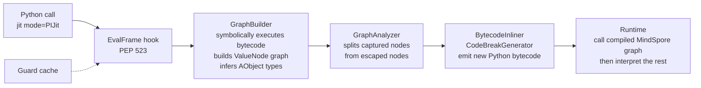
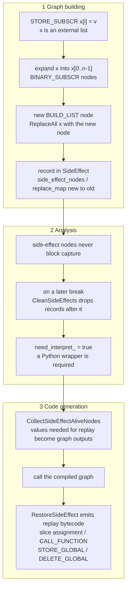

# MindSpore PIJit Contributions: Side-Effect Handling and Type Inference in a Bytecode JIT

[中文版](README.md)

This repository collects every change I ([@YUNPUWU](https://github.com/YUNPUWU); upstream author names `wu-yunpu`, `吴蕴溥`, `w30010434`) contributed to Huawei's open-source AI framework [MindSpore](https://github.com/mindspore-ai/mindspore) between November 2023 and March 2024. For each change, the docs explain the problem, the design, and why I made the choices I did.

All changes were merged into upstream mainline. The `v2.3.0` tag on the GitHub mirror contains them. The detailed design docs in `docs/` are in Chinese; this page is a complete English summary.

## Summary

My work focused on **PIJit**, MindSpore's Python-bytecode-level JIT compiler, which takes the same approach as PyTorch's TorchDynamo. The main contribution is a new **side-effect handling module** (`graph_capture/side_effect.{h,cc}`). Before it, a function that assigned to an element of a list passed in by the caller broke the graph at that assignment. With it, PIJit compiles the whole function into a static graph and replays the mutation after the graph runs, so the observable behaviour stays the same. I later refactored the module into a single record-and-replay framework that also absorbed teammates' handling of global-variable writes and `dict.pop`.

I also added abstract type inference for tuple/list slicing and list repetition, fixed bytecode compatibility issues (Python 3.9 `LIST_EXTEND`, keyword-only arguments, `FOR_ITER` break points), and cleaned up static-analysis warnings in the module.

## At a glance

| Item | Value |
| --- | --- |
| Upstream | `mindspore/mindspore` on Gitee (primary) / `mindspore-ai/mindspore` on GitHub (mirror) |
| Period | 2023-11-25 to 2024-03-25 |
| PRs I opened and got merged | 13, plus 3 branch-sync PRs by teammates that carried my commits |
| Commits | 23; after de-duplicating by `git patch-id`, 12 mainline patches plus 3 branch variants with different content |
| Mainline diff | +866 / −560 lines across 19 files (including 243 lines of obsolete tests removed) |
| New files | `side_effect.h`, `side_effect.cc`, `tests/st/pi_jit/control_flow/test_side_effect.py` |

## How PIJit works

PIJit installs a PEP 523 frame-evaluation hook (`_PyInterpreterState_SetEvalFrameFunc`). When a function decorated with `@jit(mode="PIJit")` runs:



When it reaches bytecode it cannot put into a graph, PIJit **breaks the graph**: the part before the break is compiled, the rest falls back to the interpreter. Fewer breaks (`break_count_`) means more code runs as a graph. Most of my work reduces graph breaks without changing semantics.

## Contributions

| # | Topic | Problem solved | Gitee PRs |
| --- | --- | --- | --- |
| 1 | Tuple slice type inference | `t[a:b:c]` was inferred as "any value", so downstream inference stopped | !62405, !63085 |
| 2 | List repetition type inference | element types were lost after `[a, b] * n` | !63085 |
| 3 | Stop tracing at loop heads | record `kStopTraceLoop_Unsupported` so breaks land on loop boundaries | !63765 |
| 4 | `FOR_ITER` break-point fix | the end of the block was computed from the wrong instruction | !63765 |
| 5 | Conservative `store_attr` / `store_subscr` | writes mutated shared abstract objects and could corrupt other nodes' type info | !63765 |
| 6 | Python 3.9 `LIST_EXTEND` | `[1, 2, 3]` compiles to `LIST_EXTEND <const tuple>` in 3.9, which the merge logic did not handle | !63896, !63919 |
| 7 | Keyword-only arguments | generated code kept `co_kwonlyargcount`, conflicting with PIJit's flat argument packing | !63896 |
| 8 | Redundant `STORE_DEREF` removal | self-assignments of closure cells after inlining were treated as closure side effects | !65004 |
| 9 | **Side-effect module (main work)** | assigning into a caller's list broke the graph; side effects needed one record-and-replay mechanism | !65841, !66290, !66488, !66980, !66983 |
| 10 | Code quality | codecheck warnings: signed bitwise ops, implicit narrowing, reserved identifiers, missing return in switch | !67140, !67269 |

See [docs/contribution-log.md](docs/contribution-log.md) for every commit, branch and PR.

## Main work: side-effect handling

### Problem

A compiled MindSpore graph is a pure function: tensors in, tensors out, no Python objects mutated. User code, however, often looks like this:

```python
@jit(mode="PIJit")
def func(x):                 # x is a list owned by the caller
    x[0] = Tensor([1, 2])    # mutation visible to the caller
    x[1] = Tensor([1, 2])
    return x
```

`GraphBuilder::DoSetItem` could only rewrite stores into containers created inside the function with `BUILD_LIST` / `BUILD_MAP`. For an external list it returned `false`, tracing stopped, and the function broke there.

### Design: record, replace, replay



Key decisions:

1. **Pure data flow inside the graph, real mutation outside it.** Inside the graph, the modified list is a new `BUILD_LIST` node, so type inference and compilation do not need to reason about mutability. Mutations visible to the caller are replayed on the real objects by generated bytecode after the graph returns.
2. **A new-to-old replacement map.** `ReplaceAll(old, new)` redirects locals, stack slots and closure cells in the current frame (and parent frames, for inlined calls) to the new node, and the map remembers which original object to update during replay. To make this possible I relaxed the `ReplaceAll` check so that pure reads (`IsGeneralNoSideEffectOp`, e.g. `BINARY_SUBSCR`) referencing the old node no longer block replacement.
3. **Replay must agree with the break point.** If the function breaks later for another reason, the interpreter executes the remaining bytecode, including its side effects. `CleanSideEffects(stop_bci)` drops records at or after the break so nothing runs twice.
4. **Across inlined calls.** Each inlined sub-graph (e.g. `x[1] = y` inside a `Cell.construct`) has its own `SideEffect`. `BytecodeInliner::CollectTracedNodes` merges them into the top-level graph with `SideEffect::Merge`, and replay happens once at the top.

### Two iterations

| Version | Commit | Structure |
| --- | --- | --- |
| v1 | `support side effect` (2024-02-02) | Introduced `SideEffect`, but the recorded nodes, replacement map and break bci were also stored as separate `Graph` members and copied over by hand; replay lived in `CodeBreakGenerator::CallSideEffectCode`; alive-node collection was written twice, in `BytecodeInliner::Rebuild` and `CodeBreakGenerator::Init` |
| v2 | `fix side effect bug` (2024-03-12, PR !66488) | Refactored around single responsibility: `Graph` owns one `unique_ptr<SideEffect>`, and recording, alive-node collection (`CollectSideEffectAliveNodes`), break clean-up (`CleanSideEffects`), sub-graph merge (`Merge`) and replay (`RestoreSideEffect`) all live in `SideEffect`. The original `STORE_SUBSCR` is also kept as a node so the write is applied to the caller's object, and `dict.pop` calls are recorded directly as side-effect nodes |

Between the two versions a teammate's `support dict` commit added `GlobalSideEffectNode` (for `STORE_GLOBAL` / `DELETE_GLOBAL`) and initial `dict.pop` handling; v2 folded these into `SideEffect`.

I also created the system test file `test_side_effect.py` (7 cases at first, 8 after v2). It covers list item assignment, `del x[i]`, `dict.pop` on local and argument dicts, `global` assignment and deletion, and mutating a passed-in list inside `Cell.construct`. Each case asserts `get_code_extra(func)["break_count_"] == 0`, and some also check that the generated bytecode contains the replay `STORE_SUBSCR` / `DELETE_SUBSCR`.

As of the latest master on the GitHub mirror (July 2024), teammates have since rewritten the module as `SideEffectData` plus `SideEffect::Type`, covering more mutation kinds. The core idea of a new-to-old replacement map plus replay after the graph (`modified_and_replaced_map_`, `Record` / `Restore`) is still there.

## Repository layout

```
.
├── README.md / README_EN.md      overview (Chinese / English)
├── docs/                         design docs (Chinese), one per topic, plus the full commit log
├── patches/                      unmodified `git format-patch` output, original author and date kept
│   ├── 01-type-inference/ … 05-code-quality/   mainline versions, grouped by topic
│   └── variants/                 branch versions whose content differs (mstorch-infer, r2.3)
├── src/                          files I created, as of the merge of my last PR
├── excerpts/                     full upstream functions that contain my changes
├── scripts/collect_contributions.sh   re-extracts all commits from the upstream mirror
└── LICENSE / NOTICE              Apache-2.0; original copyright Huawei Technologies Co., Ltd.
```

## Verify and reproduce

I searched the mindspore, docs, models, mindformers, mindscience, akg and mindspore-lite repositories on the GitHub mirror; only the main mindspore repository has my commits. PR descriptions and review comments on Gitee are not included.

Every commit can be viewed on the GitHub mirror, e.g. the v2 refactor [a080689](https://github.com/mindspore-ai/mindspore/commit/a08068927d5e939aa49fa0b24b2a0c50ba18a235). To re-extract everything:

```bash
bash scripts/collect_contributions.sh     # treeless clone (~50 MB), lists commits and PRs, exports de-duplicated patches
```

## What I would improve today

- `DoItemAccess` ignores `DoSideEffect`'s return value. When the index is out of range or `ReplaceAll` fails, the store is neither recorded nor turned into a graph break, so it is silently lost.
- `SideEffect::CleanSideEffects` erases from a vector inside a range-for over the same vector (iterator invalidation); it should use `erase(remove_if(...))`.
- After the Python 3.7 fix, the new list node is built from the pre-write elements, so a read after a write in the same function (`x[0] = t; y = x[0] + 1`) may see the old value inside the graph. This needs a test to confirm.
- `AbstractTuple::GetItem` ignores `start` when `step > 1`, so `t[1::2]` picks the wrong elements.
- The side-effect tests only assert the break count and the presence of replay instructions; they should also compare results with eager execution.

## License

Patches, snapshots and excerpts come from MindSpore under the [Apache License 2.0](LICENSE); original copyright belongs to Huawei Technologies Co., Ltd. This is a personal portfolio, not affiliated with Huawei or the MindSpore community. The documentation was written by me.
