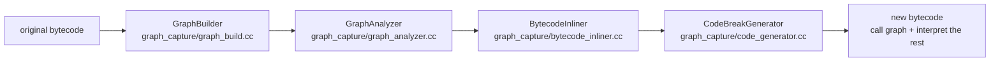

# PIJit Primer

This document gives background to readers who have not worked with PIJit; the design documents that follow build on the concepts introduced here. It describes the code as of MindSpore r2.3 (March 2024), and all paths are relative to `mindspore/ccsrc/pipeline/jit/pi/`.

## 1. Why PIJit exists

MindSpore has two execution modes:

- **Static graph (`PSJit`, GRAPH_MODE)**: parses the AST of the Python source, translates it into MindSpore IR and compiles it as a whole. It is fast, but supports only a subset of Python syntax; code that is even slightly "dynamic" fails to compile.
- **Dynamic graph (PYNATIVE_MODE)**: runs Python statement by statement. It is flexible but slow.

PIJit takes the middle road and is used as `jit(fn=func, mode="PIJit")`. It works at the **Python bytecode** level: the parts that can be compiled into a graph are compiled, and the parts that cannot are handed back to the interpreter. Users do not need to rewrite their code to make it compilable. This is the same approach as TorchDynamo in PyTorch 2.x.

## 2. Entry point: the PEP 523 frame-evaluation hook

`common.cc` uses `_PyInterpreterState_SetEvalFrameFunc` to replace CPython's frame-evaluation function with `pijit::EvalFrame`. When a marked function is called:

1. It first checks the **guard cache** (`graph_guard/`). If the function was compiled before and this call's inputs satisfy the guard conditions recorded at compile time, the compiled result is reused directly.
2. Otherwise it runs the compilation pipeline, produces a new Python code object, replaces the original function's `f_code` with it, and executes it.

## 3. The compilation pipeline

### 3.1 GraphBuilder: symbolic execution of bytecode

`GraphBuilder::TraceRun` starts at the first instruction and "executes" the bytecode one instruction at a time on a simulated frame (`FrameStates`: locals, operand stack, closures). `DoByteCode` dispatches each instruction to its handler; for example, `DoItemAccess` handles `BINARY_SUBSCR` / `STORE_SUBSCR` and `DoGlobalAccess` handles `LOAD_GLOBAL` / `STORE_GLOBAL`.

This produces two kinds of data:

- **The ValueNode graph**: every value is a `ValueNode` that records the opcode that produced it, its input nodes and its bci. A function call is a `CallNode`, which can carry an inlined sub-graph.
- **AObject abstract types** (`abstract_object.cc`): every `ValueNode` has an `AObject` describing what kind of object it is, whether its concrete value is known, and what types its elements have. For example, `AbstractTuple` records the `AObject` of each element. The more precise the type inference, the more can be put into the graph later.

When an instruction cannot be handled, `StopTraceAt(bci, reason)` records a break point and tracing stops.

### 3.2 GraphAnalyzer: deciding what goes into the graph

`GraphAnalyzer::Analyze` works backwards from the return value and the variables alive at the break point, and splits the nodes into two groups:

- **captured**: nodes that can be handed to MindSpore for compilation, mainly tensor operations, Primitives and Cell calls.
- **escaped**: nodes that must be executed by the Python interpreter, such as calls to unknown Python functions.

At the end of the analysis it also decides `need_interpret_`: if the whole function can go into the graph and its parameters and return value are all graph-supported types, PIJit can call the graph directly without generating any Python wrapper code.

### 3.3 CodeBreakGenerator: generating new bytecode

`CodeBreakGenerator::MakeCode` produces the new code object that replaces the original function. Roughly, it emits:

1. `Build()`: bytecode for the interpreted part (escaped nodes);
2. `CallCapturedCode` + `FixInterpretOuput`: wraps the captured part in a function named `<pijit.compile>`, calls it, and unpacks the graph outputs back into locals;
3. (added by me) side-effect replay: `SideEffect::RestoreSideEffect`;
4. `CallUntrackedCode`: packs the original bytecode after the break point into a new function named `<pijit.resume>` and calls it; `BreakAtIf` / `BreakAtBlock` handle breaks inside an `if` branch and inside `with` / `try` / `for` blocks respectively;
5. `MakeReturn`.

### 3.4 Break count

Every graph break increments `get_code_extra(func)["break_count_"]`. Many cases under `tests/st/pi_jit/` use `break_count_ == 0` to decide whether a feature is fully supported, and my side-effect tests follow the same convention.

## 4. Where my changes are

| Stage | File | My changes |
| --- | --- | --- |
| Abstract types | `abstract_object.cc` | type inference for tuple slicing and list repetition |
| Graph building | `graph_build.cc` | `DoSideEffect`, the `STORE_SUBSCR` branch, constant expansion for `LIST_EXTEND`, stopping at loop heads, relaxing `ReplaceAll` |
| Graph building | `node.cc` | `store_attr` / `store_subscr` no longer modify shared abstract objects directly |
| Analysis | `graph_analyzer.cc` | `HandleCallableToGraph`, `HandleSideEffectNodeForCapture`, clearing side effects after a graph break |
| Inlining | `bytecode_inliner.cc` | merging sub-graph side effects, removing redundant `STORE_DEREF` |
| Code generation | `code_generator.cc` | `FOR_ITER` break-point fix, keyword-only arguments, side-effect alive nodes and replay |
| New module | `side_effect.h/.cc` | the `SideEffect` class |
| Tests | `tests/st/pi_jit/control_flow/test_side_effect.py` | 8 side-effect cases |
