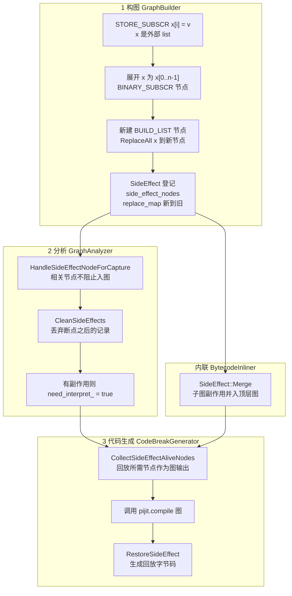
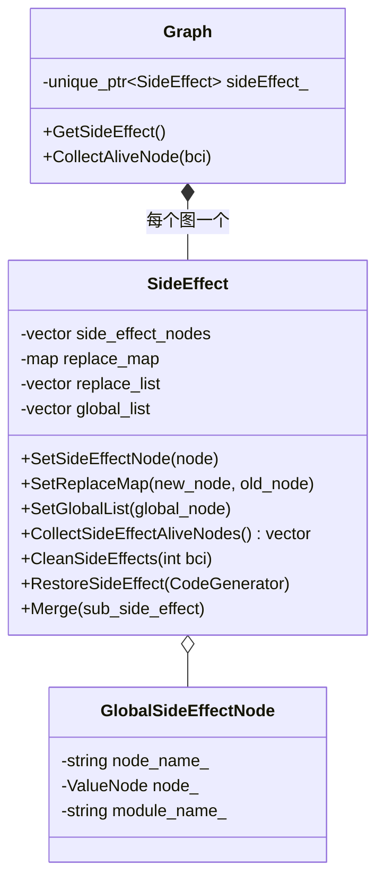

# 04 副作用处理模块（核心工作）

| 提交 | 日期 | PR | 补丁 |
| --- | --- | --- | --- |
| `c54f56e` support side effect（主线版本） | 2024-02-02 | 经 !65923 同步进主线 | [0007](../patches/04-side-effect/0007-support-side-effect.patch) |
| `5e2f080` support side effect（mstorch-infer 分支版本） | 2024-02-02 | !65841 | [variants](../patches/variants/mstorch-infer-support-side-effect.patch) |
| `819c3e7` delete fallback st | 2024-03-04 | !65841 | [variants](../patches/variants/mstorch-infer-delete-fallback-st.patch) |
| `155e73f` add side effect ut | 2024-03-11 | !66290 | [0008](../patches/04-side-effect/0008-add-side-effect-ut.patch) |
| `a080689` fix side effect bug（v2 重构） | 2024-03-12 | !66488 | [0009](../patches/04-side-effect/0009-refactor-side-effect-and-fix-bugs.patch) |
| `e24592a` fix py3.7 side effect case bug | 2024-03-22 | !66980（r2.3 分支：!66983） | [0010](../patches/04-side-effect/0010-fix-py3.7-side-effect-case.patch) |

新建文件：[`graph_capture/side_effect.h`](../src/graph_capture/side_effect.h)、[`graph_capture/side_effect.cc`](../src/graph_capture/side_effect.cc)、[`tests/st/pi_jit/control_flow/test_side_effect.py`](../src/tests/test_side_effect.py)。

涉及的上游函数（完整函数体）：[构图](../excerpts/side_effect_graph_build.cc)、[分析](../excerpts/side_effect_graph_analyzer.cc)、[代码生成](../excerpts/side_effect_code_generator.cc)、[内联](../excerpts/side_effect_bytecode_inliner.cc)。

---

## 1. 问题

MindSpore 编译出的图是纯函数：输入 Tensor，输出 Tensor，不能修改任何 Python 对象。下面这些写法却都会修改调用方或模块能看到的状态：

```python
def f(x):          # x 是调用方的 list
    x[0] = t       # 修改调用方的对象
    return x

def g(d):
    d.pop("b")     # 修改调用方的 dict
    return d

def h():
    global tmp
    tmp = t        # 修改模块的全局变量
    return tmp
```

改动前，`GraphBuilder::DoItemAccess` 处理 `STORE_SUBSCR` 时直接 `return DoSetItem(m, k, v)`。而 `DoSetItem` 只认识函数内部用 `BUILD_LIST` / `BUILD_MAP` 新建的容器，它能把“改一个元素”改写成“建一个新容器”。容器来自参数、全局变量或者其他函数的返回值时，`DoSetItem` 返回 `false`，追踪在这条指令上停下，函数在这里断图。

这类写法在模型代码里并不少见，例如在 `Cell.construct` 里往传入的列表写结果。

## 2. 总体设计：记录 → 替换 → 回放



核心思想有三点：

1. **图里只有纯数据流。** “修改后的列表”在图里是一个新的 `BUILD_LIST` 节点，类型推导、算子融合等优化都不需要关心可变性。
2. **修改发生在图外。** 图执行完之后，生成的 Python 字节码在真实对象上回放修改，目标是让调用方看到的结果和直接执行原函数一致。
3. **回放的范围和断图位置一致。** 断点之前的副作用由 PIJit 回放，断点之后的副作用由解释器执行原字节码时自然发生，设计目标是两边既不重叠也不遗漏。

## 3. 构图阶段：`GraphBuilder::DoSideEffect`

`STORE_SUBSCR` 的分支改为：先尝试原来的 `DoSetItem`；失败时如果容器是 list，交给新的 `DoSideEffect`；其他类型记录成一个普通的 `STORE_SUBSCR` 节点并标记 `kHasAttrSideEffect`，交给解释器执行，而不是像原来那样直接停止追踪（示意代码，省略了后来其他人加入的切片下标检查）：

```cpp
case STORE_SUBSCR: {
  // CPython 语义：TOS1[TOS] = TOS2，依次弹出 key、container、value
  auto k = pop();
  auto m = pop();
  auto v = pop();
  if (DoSetItem(m, k, v)) {
    return true;                       // 函数内新建的 BUILD_LIST / BUILD_MAP，原逻辑可处理
  }
  if (m->GetVobj()->GetType() == AObject::kTypeList) {
    DoSideEffect(instr, {k, m, v});    // 外部 list：走副作用路径
    break;
  }
  NewValueNode(nullptr, instr, {v, m, k});
  current_block_->SetTrackResult(Block::kHasAttrSideEffect);
  break;
}
```

`DoSideEffect` 的步骤（v2 之后的最终版本，有删减，完整代码见 [excerpts](../excerpts/side_effect_graph_build.cc)）：

```cpp
bool GraphBuilder::DoSideEffect(const Instr &instr, const std::vector<ValueNode *> &p) {
  auto key = p[0], container = p[1], value = p[2];
  PyObject *container_object = container->GetVobj()->GetPyObject().ptr();
  if (container_object == nullptr || !PyList_Check(container_object)) {
    return false;                                   // 只处理追踪时能拿到真实对象的 list
  }
  // 1. 按追踪时的真实长度，把容器展开成 container[0..n-1]
  std::vector<ValueNode *> items;
  for (Py_ssize_t i = 0; i < PyList_Size(container_object); i++) {
    ValueNode *index_node = NewValueNode(AObject::Convert(py::int_(i)), LOAD_CONST, -1, {});
    items.push_back(NewValueNode(AObject::Convert(PyList_GET_ITEM(container_object, i)),
                                 BINARY_SUBSCR, 0, {container, index_node}));
  }
  // 2. 检查下标，越界时返回 false
  ...
  // 3. 新建 BUILD_LIST 节点，把当前帧（以及父帧）里对旧容器的引用替换掉
  new_node = NewValueNode(object_info, BUILD_LIST, items.size(), items);
  if (!ReplaceAll(container, new_node)) {
    return false;
  }
  // 4. 原始 STORE_SUBSCR 也记录为节点，用于在真实对象上执行写入
  NewValueNode(nullptr, instr, {value, container, key});
  // 5. 登记
  graph_->GetSideEffect()->SetSideEffectNode(new_node);
  graph_->GetSideEffect()->SetReplaceMap(new_node, container);   // 新 -> 旧
  graph_->GetTracedNodes().push_back(new_node);
  return true;
}
```

几个细节：

- **为什么要展开成 `BINARY_SUBSCR`？** 图里没有“外部 list”这种值，只有它的各个元素。展开之后，新列表的每个元素都是一个可以入图的节点，`x[0] + x[1]` 这样的后续计算可以继续追踪。
- **为什么要 `ReplaceAll`？** 后续字节码通过局部变量、栈或闭包访问 `x`，必须让它们改为引用新节点。`ReplaceAll` 会同时替换当前帧和父帧（内联场景）中的引用。
- **放宽 `ReplaceAll` 的检查。** `ReplaceAll` 原本发现任何已追踪节点引用了旧节点就拒绝替换，因为那可能意味着旧对象的身份已经被别处依赖。但 `DoSideEffect` 自己刚生成的 `BINARY_SUBSCR` 就引用了旧容器。我把检查改为跳过 `Utils::IsGeneralNoSideEffectOp` 判定为“无副作用”的节点：纯读操作引用旧节点，不妨碍替换。
- **只处理 `PyList`。** list 的长度和元素在追踪时可以从真实对象读到；`dict`、自定义容器暂时还是走原有路径。

## 4. 数据结构：`SideEffect`

v2 之后的结构（`GlobalSideEffectNode` 由同事在 `support dict` 提交中加入，v2 把它并进了 `SideEffect`）：



| 成员 | 含义 |
| --- | --- |
| `side_effect_nodes` | 需要回放的副作用节点：list 写入对应的新 `BUILD_LIST` 节点，或 `dict.pop` 这类 `CALL_FUNCTION` 节点 |
| `replace_map` | 新节点到原容器节点的映射，回放时用来找回调用方持有的原对象 |
| `replace_list` | 子图合并上来的替换节点列表 |
| `global_list` | `STORE_GLOBAL` / `DELETE_GLOBAL` 记录，节点为空表示删除 |

| 方法 | 调用位置 | 作用 |
| --- | --- | --- |
| `CollectSideEffectAliveNodes` | `Graph::CollectAliveNode`、`CodeBreakGenerator::Init` / `MakeCode` | 列出回放时要用到的节点，它们必须作为图的输出返回 |
| `CleanSideEffects(bci)` | `GraphAnalyzer::Analyze` | 断图时删除 bci 不早于断点的记录 |
| `Merge(sub)` | `BytecodeInliner::CollectTracedNodes` | 把被内联子图的副作用并入顶层图 |
| `RestoreSideEffect(cg)` | `CodeBreakGenerator::MakeCode` | 生成回放字节码 |

## 5. 分析阶段

`GraphAnalyzer` 里有三处改动：

- **`HandleSideEffectNodeForCapture`。** `TryToCapture` 一开始先检查节点是不是替换表里的原容器，或者是被登记为副作用的 `CALL_FUNCTION`。是的话直接返回成功。否则这些节点既不是 Tensor 运算、也不能交给解释器单独执行，会落到 `TryToCapture` 末尾“无法捕获、断图”的分支。
- **`CleanSideEffects(stop_bci)`。** 发生断图时，bci 不早于断点的副作用记录都会被删掉。断点之后的字节码会由解释器原样执行，如果再回放一次就重复了。
- **强制生成包装代码。** 只要存在副作用记录或全局变量记录，就设置 `need_interpret_ = true`。否则函数可能被判定为“整段都是图”而直接调用图，副作用就没有机会回放了。

## 6. 代码生成阶段

`CodeBreakGenerator::Init` 把 `CollectSideEffectAliveNodes()` 的结果追加到 `interpret_.outputs`，图的输出（`captured_.outputs`）由此包含回放要用的值。`MakeCode` 中的顺序是：

```
Build()                      解释执行部分
CallCapturedCode()           调用 <pijit.compile> 图
FixInterpretOuput()          拆包图的输出
RestoreSideEffect()          回放副作用（只在 make_graph == false 时）
interpret_.outputs.resize()  去掉 Init 中为回放追加的那份输出
CallUntrackedCode()          调用 <pijit.resume>
MakeReturn()
```

`RestoreSideEffect` 为每类副作用生成的字节码如下：

| 副作用 | 生成的字节码 | 等价的 Python |
| --- | --- | --- |
| list 元素写入 | `LOAD <原列表>`、`LOAD <新列表>`、`LOAD_CONST None` ×2、`BUILD_SLICE`、`STORE_SUBSCR` | `新列表[:] = 原列表`（`STORE_SUBSCR` 执行 `TOS1[TOS] = TOS2`） |
| `dict.pop` 等调用 | 依次 `LOAD` 调用的输入，再 `CALL_FUNCTION n` | 重放这次调用 |
| 全局变量赋值 | `LOAD <值>`、`STORE_GLOBAL` | `global name; name = 值` |
| 全局变量删除 | `DELETE_GLOBAL` | `del name` |

list 写入的处理方式是：从 v2 开始，原始 `STORE_SUBSCR` 也作为一个节点留在已追踪节点里，用来在调用方的原列表上执行这次写入；之后的整表切片赋值把原列表的内容同步给图中的新列表对象，后续引用新节点的代码看到的就是写入后的内容。切片赋值是原地修改，不会创建新的列表对象。

## 7. 跨函数的副作用

模型代码里，副作用往往发生在被调用的函数里：

```python
class NetAssign0002(Cell):
    def construct(self, x, y):
        x[1] = y          # 副作用发生在被内联的 construct 里
        return x

def func():
    net = NetAssign0002()
    x = [Tensor([1, 2]), Tensor([2, 3])]
    out = net(x, Tensor([5, 6]))
    return x              # 调用方必须看到 x[1] 被修改
```

每个 `Graph`（包括内联的子图）都有自己的 `SideEffect`。`BytecodeInliner::CollectTracedNodes` 递归收集子图节点时，对非顶层图调用 `graph_->GetSideEffect()->Merge(graph->GetSideEffect())`，把子图的副作用节点、替换表和全局变量记录合并到顶层图，最终在顶层统一回放。测试 `test_fix_bug_store_subscr_side_effect_1` 就是这个场景。

## 8. v1 到 v2 的演进

v1（`support side effect`，2024-02-02）先把功能做通，v2（`fix side effect bug`，2024-03-12，+246 / −201 行）是重构加修复：

| 方面 | v1 | v2 |
| --- | --- | --- |
| 状态存放 | `Graph` 中新增 `side_effect_nodes_`、`replace_map`、`old_break_bci_`，另外 `SideEffect` 里还有一份 `VariableMutationMaps` / `replaceMaps`，两边需要手动同步 | 只放在 `SideEffect` 中，`Graph` 只持有 `unique_ptr<SideEffect>` |
| 存活节点收集 | `BytecodeInliner::Rebuild` 和 `CodeBreakGenerator::Init` 各写了一份 | 统一为 `SideEffect::CollectSideEffectAliveNodes` |
| 回放 | `CodeBreakGenerator::CallSideEffectCode` | `SideEffect::RestoreSideEffect`，代码生成器只负责在合适的位置调用 |
| 断点清理 | 用 `old_break_bci_` 和当前断点比较，在 `GraphAnalyzer::Analyze` 和 `BytecodeInliner` 两处删除 | `SideEffect::CleanSideEffects(bci)` 一处完成 |
| 子图 | 在 `CollectTracedNodes` 中逐项拷贝 | `SideEffect::Merge` |
| 原始写入 | 未保留原始 `STORE_SUBSCR` | 原始 `STORE_SUBSCR` 也作为节点记录下来，用于在原对象上执行写入 |
| `dict.pop` | v1 未处理；之后同事的 `support dict` 把它推导为 `get` 的结果再登记 | 直接把调用节点登记为副作用，返回 `false`，不再当作常量折叠 |

重构的出发点是**单一职责**：副作用的数据和行为都属于 `SideEffect`，`Graph`、`GraphAnalyzer`、`CodeBreakGenerator` 只在各自阶段调用它的接口。这样新增一种副作用类型时，改动可以集中在 `SideEffect` 和 `GraphBuilder` 中。

## 9. Python 3.7 用例修复

`fix py3.7 side effect case bug`（!66980，r2.3 分支 !66983）只改了两处：

- 把 `items[index] = value` 挪到新 `BUILD_LIST` 节点创建之后。由于节点创建时复制了 `items`，新列表节点改为由写入前的元素构建，写入只由保留下来的原始 `STORE_SUBSCR` 执行。
- 删除 `RestoreSideEffect` 中残留的 `std::cout` 调试输出。

## 10. 测试

`tests/st/pi_jit/control_flow/test_side_effect.py` 是我新建的（第一次提交 7 个用例，v2 中调整为 8 个）：

| 用例 | 场景 | 断言 |
| --- | --- | --- |
| `test_store_subscr_side_effect_1` | 修改参数 list 的两个元素 | 编译后的字节码含 `STORE_SUBSCR`，`break_count_ == 0` |
| `test_store_subscr_side_effect_2` | 修改函数内新建的 list | `break_count_ == 0` |
| `test_del_subscr_side_effect_3` | `del arg[0]` | 字节码含 `DELETE_SUBSCR`，`break_count_ == 0` |
| `test_dict_pop_side_effect_4` | 局部 dict 的 `pop` | `break_count_ == 0` |
| `test_dict_pop_side_effect_5` | 参数 dict 的 `pop` | `break_count_ == 0` |
| `test_store_global_side_effect_6` | `global tmp; tmp = ...; tmp *= 2` | `break_count_ == 0` |
| `test_del_global_side_effect_7` | 在上例基础上 `del tmp` | `break_count_ == 0` |
| `test_fix_bug_store_subscr_side_effect_1` | 在 `Cell.construct` 中修改传入的 list | `break_count_ == 0` |

v2 中还调整了第一版测试：用例 7 原本和用例 6 内容完全一样（漏写了 `del`），补上了；用例 1 增加了对编译后字节码的检查；`x[0] += 1` 的用例被移除；新增了参数 dict 的 `pop` 和 `Cell` 内修改 list 两个用例。

## 11. 后续演进

截至 GitHub 镜像最新的 master（2024-07），社区同事把这个模块重构成了 `SideEffectData`（整个编译过程共享的对象跟踪表、属性缓存和全局变量缓存）加 `SideEffect::Type`（`kSetAttr`、`kSetGlobal`、`kListSetItem`、`kDictSetItem`、`kListAppend`、`kDictPop` 等）的形式，支持的副作用类型更多了。“新值到旧值的替换表”（`modified_and_replaced_map_`）和“记录后在图外回放（`Record` / `Restore`）”这套框架保留了下来。

## 12. 不足与改进方向

- **遍历中删除。** `CleanSideEffects` 在范围 for 循环里对同一个 vector 调用 `erase`，迭代器会失效，应改为 `erase(std::remove_if(...), end())`。v1 的 `ReprocessVariableMutationMaps` 在遍历 `std::map` 时也有同样的问题。
- **存活节点重复追加。** v2 里 `Graph::CollectAliveNode` 和 `CodeBreakGenerator::Init` 各追加了一次副作用存活节点，依赖 `MakeCode` 中的 `resize` 抵消。这种隐式约定很脆弱，应该只在一处追加。
- **写后读可能读到旧值（待验证）。** py3.7 修复之后，新列表节点由写入前的元素构建，而 `ReplaceAll` 已经让后续字节码引用这个新节点。回看代码时我认为，像 `x[0] = t; y = x[0] + 1` 这样在同一个函数里先写后读的情况，图里算 `y` 时可能拿到旧的 `x[0]`。应补一个写后读的用例确认；如果确实如此，正确做法是新节点包含新值，同时确保原对象上的写入只回放一次。
- **测试没有验证值。** 用例只检查断图次数和字节码里是否有回放指令，没有比较执行后调用方对象的内容和身份。应补充“和不加 `jit` 的执行结果逐元素比较”的测试。
- **忽略了 `DoSideEffect` 的返回值。** `STORE_SUBSCR` 分支调用 `DoSideEffect` 后直接 `break`。下标越界、拿不到真实对象或 `ReplaceAll` 失败时，`DoSideEffect` 返回 `false`，但这条写入既没有被记录，也没有触发断图，会被悄悄丢掉。应该在返回 `false` 时停止追踪，走原来的断图路径。
- **覆盖面。** 只处理 list 的下标写入；`dict` 下标写入、`list.append`、属性写入仍然走原路径，这些后来在社区重构中通过 `SideEffect::Type` 统一了起来。
