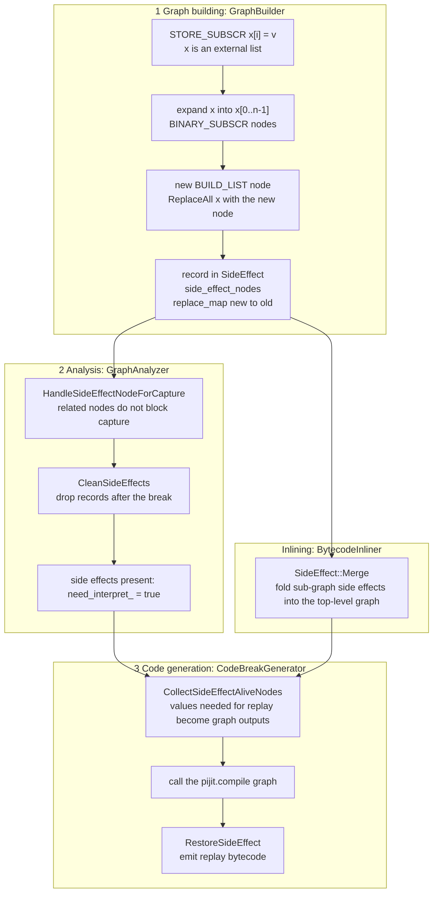
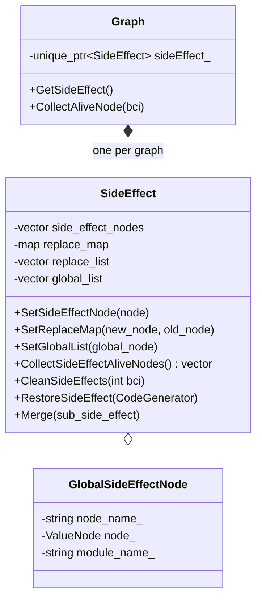

# 04 The Side-Effect Handling Module (Main Work)

| Commit | Date | PR | Patch |
| --- | --- | --- | --- |
| `c54f56e` support side effect (mainline version) | 2024-02-02 | synced into mainline via !65923 | [0007](../patches/04-side-effect/0007-support-side-effect.patch) |
| `5e2f080` support side effect (mstorch-infer branch version) | 2024-02-02 | !65841 | [variants](../patches/variants/mstorch-infer-support-side-effect.patch) |
| `819c3e7` delete fallback st | 2024-03-04 | !65841 | [variants](../patches/variants/mstorch-infer-delete-fallback-st.patch) |
| `155e73f` add side effect ut | 2024-03-11 | !66290 | [0008](../patches/04-side-effect/0008-add-side-effect-ut.patch) |
| `a080689` fix side effect bug (v2 refactor) | 2024-03-12 | !66488 | [0009](../patches/04-side-effect/0009-refactor-side-effect-and-fix-bugs.patch) |
| `e24592a` fix py3.7 side effect case bug | 2024-03-22 | !66980 (r2.3 branch: !66983) | [0010](../patches/04-side-effect/0010-fix-py3.7-side-effect-case.patch) |

New files: [`graph_capture/side_effect.h`](../src/graph_capture/side_effect.h), [`graph_capture/side_effect.cc`](../src/graph_capture/side_effect.cc), [`tests/st/pi_jit/control_flow/test_side_effect.py`](../src/tests/test_side_effect.py).

Upstream functions involved (full bodies): [graph building](../excerpts/side_effect_graph_build.cc), [analysis](../excerpts/side_effect_graph_analyzer.cc), [code generation](../excerpts/side_effect_code_generator.cc), [inlining](../excerpts/side_effect_bytecode_inliner.cc).

---

## 1. Problem

A graph compiled by MindSpore is a pure function: tensors in, tensors out, and it cannot modify any Python object. Yet each of the following modifies state that the caller or the module can see:

```python
def f(x):          # x is the caller's list
    x[0] = t       # modifies the caller's object
    return x

def g(d):
    d.pop("b")     # modifies the caller's dict
    return d

def h():
    global tmp
    tmp = t        # modifies a module-level global
    return tmp
```

Before this work, `GraphBuilder::DoItemAccess` handled `STORE_SUBSCR` with a plain `return DoSetItem(m, k, v)`. `DoSetItem` only understands containers created inside the function with `BUILD_LIST` / `BUILD_MAP`, which it can rewrite from "change one element" into "build a new container". When the container came from a parameter, a global or the return value of another function, `DoSetItem` returned `false`, tracing stopped at that instruction, and the function broke there.

This pattern is not unusual in model code, for example writing results into a list passed to `Cell.construct`.

## 2. Overall design: record, replace, replay



Three core ideas:

1. **Only pure data flow inside the graph.** "The modified list" is a new `BUILD_LIST` node in the graph, so type inference, operator fusion and other optimizations never need to reason about mutability.
2. **Mutation happens outside the graph.** After the graph has run, generated Python bytecode replays the mutation on the real objects; the goal is that the caller sees the same result as running the original function directly.
3. **The replay scope matches the break point.** Side effects before the break point are replayed by PIJit; side effects after it happen naturally when the interpreter runs the original bytecode. The design goal is that the two neither overlap nor miss anything.

## 3. Graph building: `GraphBuilder::DoSideEffect`

The `STORE_SUBSCR` branch now first tries the original `DoSetItem`. If that fails and the container is a list, it hands over to the new `DoSideEffect`. Other container types are recorded as a plain `STORE_SUBSCR` node marked `kHasAttrSideEffect` and left to the interpreter, instead of stopping tracing as before (sketch; the slice-index check that others added later is omitted):

```cpp
case STORE_SUBSCR: {
  // CPython semantics: TOS1[TOS] = TOS2; pops key, container, value in that order
  auto k = pop();
  auto m = pop();
  auto v = pop();
  if (DoSetItem(m, k, v)) {
    return true;                       // BUILD_LIST / BUILD_MAP created in this function: old logic handles it
  }
  if (m->GetVobj()->GetType() == AObject::kTypeList) {
    DoSideEffect(instr, {k, m, v});    // external list: take the side-effect path
    break;
  }
  NewValueNode(nullptr, instr, {v, m, k});
  current_block_->SetTrackResult(Block::kHasAttrSideEffect);
  break;
}
```

The steps of `DoSideEffect` (final version after v2, abridged; see [excerpts](../excerpts/side_effect_graph_build.cc) for the full code):

```cpp
bool GraphBuilder::DoSideEffect(const Instr &instr, const std::vector<ValueNode *> &p) {
  auto key = p[0], container = p[1], value = p[2];
  PyObject *container_object = container->GetVobj()->GetPyObject().ptr();
  if (container_object == nullptr || !PyList_Check(container_object)) {
    return false;                                   // only lists whose real object is available at trace time
  }
  // 1. expand the container into container[0..n-1], using its real length at trace time
  std::vector<ValueNode *> items;
  for (Py_ssize_t i = 0; i < PyList_Size(container_object); i++) {
    ValueNode *index_node = NewValueNode(AObject::Convert(py::int_(i)), LOAD_CONST, -1, {});
    items.push_back(NewValueNode(AObject::Convert(PyList_GET_ITEM(container_object, i)),
                                 BINARY_SUBSCR, 0, {container, index_node}));
  }
  // 2. check the index; return false if it is out of range
  ...
  // 3. create the BUILD_LIST node and replace references to the old container in this frame (and parent frames)
  new_node = NewValueNode(object_info, BUILD_LIST, items.size(), items);
  if (!ReplaceAll(container, new_node)) {
    return false;
  }
  // 4. also record the original STORE_SUBSCR as a node, used to perform the write on the real object
  NewValueNode(nullptr, instr, {value, container, key});
  // 5. register
  graph_->GetSideEffect()->SetSideEffectNode(new_node);
  graph_->GetSideEffect()->SetReplaceMap(new_node, container);   // new -> old
  graph_->GetTracedNodes().push_back(new_node);
  return true;
}
```

A few details:

- **Why expand into `BINARY_SUBSCR`?** There is no such value as "an external list" inside the graph, only its elements. After expansion, every element of the new list is a node that can go into the graph, so follow-up computations such as `x[0] + x[1]` can still be traced.
- **Why `ReplaceAll`?** Later bytecode reaches `x` through locals, the stack or closures, and all of those must be switched to reference the new node. `ReplaceAll` replaces references in both the current frame and its parent frames (for inlining).
- **Relaxing the `ReplaceAll` check.** `ReplaceAll` used to refuse the replacement whenever any traced node referenced the old node, since that could mean the old object's identity was relied on elsewhere. But the `BINARY_SUBSCR` nodes that `DoSideEffect` had just created reference the old container themselves. I changed the check to skip nodes that `Utils::IsGeneralNoSideEffectOp` classifies as side-effect free: a pure read referencing the old node does not prevent the replacement.
- **Only `PyList`.** A list's length and elements can be read from the real object at trace time; `dict` and custom containers still take the original path for now.

## 4. Data structure: `SideEffect`

The structure after v2 (`GlobalSideEffectNode` was added by a teammate in the `support dict` commit; v2 folded it into `SideEffect`):



| Member | Meaning |
| --- | --- |
| `side_effect_nodes` | side-effect nodes to replay: the new `BUILD_LIST` node for a list write, or a `CALL_FUNCTION` node such as `dict.pop` |
| `replace_map` | maps each new node to the original container node; used during replay to find the original object the caller holds |
| `replace_list` | replacement nodes merged up from sub-graphs |
| `global_list` | `STORE_GLOBAL` / `DELETE_GLOBAL` records; a null node means deletion |

| Method | Called from | Purpose |
| --- | --- | --- |
| `CollectSideEffectAliveNodes` | `Graph::CollectAliveNode`, `CodeBreakGenerator::Init` / `MakeCode` | lists the nodes replay needs; they must be returned as graph outputs |
| `CleanSideEffects(bci)` | `GraphAnalyzer::Analyze` | on a graph break, deletes records whose bci is at or after the break point |
| `Merge(sub)` | `BytecodeInliner::CollectTracedNodes` | folds an inlined sub-graph's side effects into the top-level graph |
| `RestoreSideEffect(cg)` | `CodeBreakGenerator::MakeCode` | emits the replay bytecode |

## 5. Analysis

Three changes in `GraphAnalyzer`:

- **`HandleSideEffectNodeForCapture`.** At its start, `TryToCapture` checks whether the node is an original container in the replacement map, or a `CALL_FUNCTION` registered as a side effect. If so, it returns success right away. Otherwise these nodes, which are neither tensor operations nor something the interpreter can execute on its own, would fall through to the "cannot capture, break the graph" branch at the end of `TryToCapture`.
- **`CleanSideEffects(stop_bci)`.** When the graph breaks, every side-effect record whose bci is at or after the break point is deleted. The bytecode after the break point is executed by the interpreter as is, and replaying those records as well would apply them twice.
- **Forcing wrapper code.** Whenever there are side-effect records or global-variable records, `need_interpret_` is set to `true`. Otherwise the function might be judged to be "all graph" and the graph called directly, leaving the side effects no chance to be replayed.

## 6. Code generation

`CodeBreakGenerator::Init` appends the result of `CollectSideEffectAliveNodes()` to `interpret_.outputs`, so the graph outputs (`captured_.outputs`) include the values replay needs. The order inside `MakeCode` is:

```
Build()                      interpreted part
CallCapturedCode()           call the <pijit.compile> graph
FixInterpretOuput()          unpack the graph outputs
RestoreSideEffect()          replay side effects (only when make_graph == false)
interpret_.outputs.resize()  drop the outputs Init appended for replay
CallUntrackedCode()          call <pijit.resume>
MakeReturn()
```

The bytecode `RestoreSideEffect` emits for each kind of side effect:

| Side effect | Emitted bytecode | Equivalent Python |
| --- | --- | --- |
| list element write | `LOAD <original list>`, `LOAD <new list>`, `LOAD_CONST None` ×2, `BUILD_SLICE`, `STORE_SUBSCR` | `new_list[:] = original_list` (`STORE_SUBSCR` performs `TOS1[TOS] = TOS2`) |
| calls such as `dict.pop` | `LOAD` each input of the call, then `CALL_FUNCTION n` | replays the call |
| global assignment | `LOAD <value>`, `STORE_GLOBAL` | `global name; name = value` |
| global deletion | `DELETE_GLOBAL` | `del name` |

For list writes: from v2 on, the original `STORE_SUBSCR` also stays in the traced nodes as a node, used to perform the write on the caller's original list; the whole-list slice assignment then copies the original list's contents into the new list object from the graph, so code that references the new node sees the contents after the write. Slice assignment modifies the list in place and does not create a new list object.

## 7. Side effects across function calls

In model code, side effects often happen in a called function:

```python
class NetAssign0002(Cell):
    def construct(self, x, y):
        x[1] = y          # the side effect happens inside the inlined construct
        return x

def func():
    net = NetAssign0002()
    x = [Tensor([1, 2]), Tensor([2, 3])]
    out = net(x, Tensor([5, 6]))
    return x              # the caller must see x[1] modified
```

Every `Graph`, including inlined sub-graphs, has its own `SideEffect`. While `BytecodeInliner::CollectTracedNodes` recursively collects sub-graph nodes, it calls `graph_->GetSideEffect()->Merge(graph->GetSideEffect())` for each graph other than the top-level one. This merges the sub-graph's side-effect nodes, replacement map and global records into the top-level graph, where everything is replayed together. The test `test_fix_bug_store_subscr_side_effect_1` covers exactly this case.

## 8. From v1 to v2

v1 (`support side effect`, 2024-02-02) got the feature working end to end; v2 (`fix side effect bug`, 2024-03-12, +246 / −201 lines) was a refactor plus fixes:

| Aspect | v1 | v2 |
| --- | --- | --- |
| Where state lives | new `side_effect_nodes_`, `replace_map` and `old_break_bci_` members in `Graph`, plus another copy in `SideEffect` (`VariableMutationMaps` / `replaceMaps`), kept in sync by hand | only in `SideEffect`; `Graph` just holds a `unique_ptr<SideEffect>` |
| Alive-node collection | written twice, in `BytecodeInliner::Rebuild` and `CodeBreakGenerator::Init` | unified as `SideEffect::CollectSideEffectAliveNodes` |
| Replay | `CodeBreakGenerator::CallSideEffectCode` | `SideEffect::RestoreSideEffect`; the code generator only calls it at the right point |
| Break clean-up | compared `old_break_bci_` with the current break point and deleted records in two places, `GraphAnalyzer::Analyze` and `BytecodeInliner` | done in one place, `SideEffect::CleanSideEffects(bci)` |
| Sub-graphs | copied item by item in `CollectTracedNodes` | `SideEffect::Merge` |
| Original write | the original `STORE_SUBSCR` was not kept | the original `STORE_SUBSCR` is also recorded as a node, used to perform the write on the original object |
| `dict.pop` | not handled in v1; a teammate's later `support dict` inferred it as the result of `get` and recorded it | the call node is registered directly as a side effect and returns `false`, so it is no longer constant-folded |

The guiding principle of the refactor was **single responsibility**: the data and behaviour of side effects belong to `SideEffect`, while `Graph`, `GraphAnalyzer` and `CodeBreakGenerator` only call its interface at their own stage. Adding a new kind of side effect can then be confined to `SideEffect` and `GraphBuilder`.

## 9. The Python 3.7 fix

`fix py3.7 side effect case bug` (!66980; r2.3 branch !66983) changed only two things:

- It moved `items[index] = value` to after the new `BUILD_LIST` node is created. Because node creation copies `items`, the new list node is now built from the elements before the write, and the write is performed only by the retained original `STORE_SUBSCR`.
- It removed leftover `std::cout` debug output from `RestoreSideEffect`.

## 10. Tests

I created `tests/st/pi_jit/control_flow/test_side_effect.py` (7 cases in the first commit, adjusted to 8 in v2):

| Case | Scenario | Assertions |
| --- | --- | --- |
| `test_store_subscr_side_effect_1` | modify two elements of an argument list | compiled bytecode contains `STORE_SUBSCR`; `break_count_ == 0` |
| `test_store_subscr_side_effect_2` | modify a list created inside the function | `break_count_ == 0` |
| `test_del_subscr_side_effect_3` | `del arg[0]` | bytecode contains `DELETE_SUBSCR`; `break_count_ == 0` |
| `test_dict_pop_side_effect_4` | `pop` on a local dict | `break_count_ == 0` |
| `test_dict_pop_side_effect_5` | `pop` on an argument dict | `break_count_ == 0` |
| `test_store_global_side_effect_6` | `global tmp; tmp = ...; tmp *= 2` | `break_count_ == 0` |
| `test_del_global_side_effect_7` | the previous case plus `del tmp` | `break_count_ == 0` |
| `test_fix_bug_store_subscr_side_effect_1` | modify a passed-in list inside `Cell.construct` | `break_count_ == 0` |

v2 also revised the first version of the tests: case 7 had been identical to case 6 (the `del` was missing) and was fixed; case 1 gained a check on the compiled bytecode; the `x[0] += 1` case was removed; and two cases were added, `pop` on an argument dict and modifying a list inside a `Cell`.

## 11. What happened next

As of the latest master on the GitHub mirror (July 2024), teammates have rewritten the module as `SideEffectData` (an object-tracking table, attribute cache and global cache shared across the whole compilation) plus `SideEffect::Type` (`kSetAttr`, `kSetGlobal`, `kListSetItem`, `kDictSetItem`, `kListAppend`, `kDictPop` and more), supporting more kinds of side effects. The framework of a new-to-old replacement map (`modified_and_replaced_map_`) and recording followed by replay outside the graph (`Record` / `Restore`) was kept.

## 12. Weaknesses and how to improve them

- **Erasing while iterating.** `CleanSideEffects` calls `erase` on a vector inside a range-for over that same vector, which invalidates the iterator; it should be `erase(std::remove_if(...), end())`. v1's `ReprocessVariableMutationMaps` has the same problem while iterating a `std::map`.
- **Alive nodes appended twice.** In v2, both `Graph::CollectAliveNode` and `CodeBreakGenerator::Init` append the side-effect alive nodes, relying on the `resize` in `MakeCode` to cancel one copy out. That implicit contract is fragile; the nodes should be appended in exactly one place.
- **Read after write may see the old value (to be verified).** After the Python 3.7 fix, the new list node is built from the elements before the write, while `ReplaceAll` has already made later bytecode reference that node. Re-reading the code, I believe that when a function writes and then reads in the same body, as in `x[0] = t; y = x[0] + 1`, the graph may use the old `x[0]` when computing `y`. A read-after-write test case should confirm this. If so, the right fix is to include the new value in the new node while making sure the write to the original object is replayed only once.
- **The tests do not check values.** The cases only check the break count and whether replay instructions are present in the bytecode; they do not compare the contents or identity of the caller's objects after execution. Tests that compare results element by element against running without `jit` should be added.
- **`DoSideEffect`'s return value is ignored.** The `STORE_SUBSCR` branch calls `DoSideEffect` and then simply `break`s. When the index is out of range, the real object is unavailable, or `ReplaceAll` fails, `DoSideEffect` returns `false`, but the write is neither recorded nor turned into a graph break, so it is silently lost. On `false`, tracing should stop and take the original graph-break path.
- **Coverage.** Only list subscript writes are handled; `dict` subscript writes, `list.append` and attribute writes still take the original path. The later community refactor unified these through `SideEffect::Type`.
